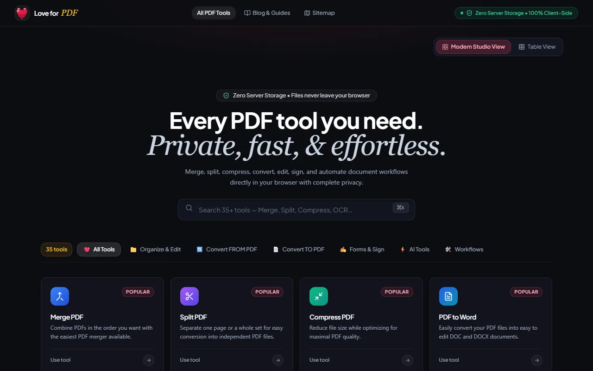

# Love for PDF

**Love for PDF is a free, web-based PDF toolkit with 35 tools to merge, split, compress, convert, edit, sign and redact PDF files, where most tools run entirely in your browser and Office conversions go through a small Python service.**

<p align="center">
  <a href="https://pdf.codingmarvel.com"></a>
  
  
  
  
  
  
  
</p>

<p align="center">
  <a href="https://pdf.codingmarvel.com"></a>
</p>

Try it at **[pdf.codingmarvel.com](https://pdf.codingmarvel.com)**. No account, no sign-up.

## Why Love for PDF

- **35 PDF tools on one site**, grouped into 6 categories: Organize & Edit, Convert from PDF, Convert to PDF, Forms & Sign, AI Tools and Workflows.
- **18 of the 35 tools never send your file anywhere.** Merge, split, rotate, crop, sign, watermark, PDF to JPG and the rest run in the browser with pdf-lib and pdf.js.
- **Real Office fidelity where it matters.** Word, Excel and PowerPoint to PDF use headless LibreOffice; PDF to Word uses pdf2docx and PyMuPDF.
- **Uploads are short-lived.** The conversion service writes each upload to a temporary directory that is removed as soon as the result has been read back, before the response is returned, and it rejects files over 50 MB by default.
- **Partly works when the server does not.** 8 tools (compress, protect, unlock, repair, PDF/A, edit, redact, HTML to PDF) try the service first and fall back to the browser if it is unreachable; the matching workflow steps behave the same way. Compress, repair, edit and HTML to PDF have real in-browser fallbacks. The protect, unlock and PDF/A fallbacks only re-save the PDF (no encryption, decryption or PDF/A conversion), and browser redaction only covers content visually, so use those four with the service running.
- **One-click workflows.** Chain up to 7 step types (watermark, rotate, page numbers, compress, protect, PDF/A, repair) and run them on one or several PDFs.

## Features

Every tool has its own page at `pdf.codingmarvel.com/<slug>`, for example [/merge-pdf](https://pdf.codingmarvel.com/merge-pdf).

### Organize and edit

| Tool | What it does | Where it runs |
|:--|:--|:--|
| Merge PDF | Combine several PDFs in the order you choose | Browser |
| Split PDF | Pull pages out into separate PDF files | Browser |
| Organize PDF | Reorder and delete pages | Browser |
| Rotate PDF | Rotate pages by 90, 180 or 270 degrees | Browser |
| Crop PDF | Trim page margins | Browser |
| Watermark | Stamp text with your own size, color, opacity and angle | Browser |
| Page numbers | Add "1" or "Page 1 of N" numbers at the top or bottom of each page | Browser |
| Grid layout | Fit several pages onto one sheet (N-up) in a custom grid | Browser |
| Compare PDF | Show two versions side by side | Browser |
| Compress PDF | Reduce file size | Service, browser fallback |
| Edit PDF | Add or replace text and annotations on a page | Service, browser fallback |
| Redact PDF | Black out text and graphics | Service (browser fallback only covers content visually) |
| Protect PDF | Add a password | Service (browser fallback does not encrypt) |
| Unlock PDF | Remove a password you know | Service (browser fallback does not decrypt) |
| Repair PDF | Re-save a damaged PDF | Service, browser fallback |

### Convert from PDF

| Tool | Output | Where it runs |
|:--|:--|:--|
| PDF to JPG | One JPG per page | Browser |
| PDF to Word | .docx | Service |
| PDF to Excel | .xlsx | Service |
| PDF to PowerPoint | .pptx | Service |
| PDF to Markdown | .md | Service |
| PDF to PDF/A | Archival PDF | Service (browser fallback only re-saves the PDF) |

### Convert to PDF

| Tool | Input | Where it runs |
|:--|:--|:--|
| JPG to PDF | Images | Browser |
| Scan to PDF | Your device camera | Browser |
| Word to PDF | .doc, .docx | Service |
| PowerPoint to PDF | .ppt, .pptx | Service |
| Excel to PDF | .xls, .xlsx, .csv | Service |
| HTML to PDF | Pasted HTML | Service, browser fallback |

### Forms, sign, text and workflows

| Tool | What it does | Where it runs |
|:--|:--|:--|
| Sign PDF | Draw a signature and place it on the page | Browser |
| PDF Forms | Add fillable form fields | Browser |
| OCR PDF | Adds an invisible text layer; real OCR needs Tesseract on the service (not in the default Dockerfile) | Service |
| Word Counter | Count words and get a Flesch reading-ease score | Browser |
| Text Copier | Extract text and copy it in word chunks | Browser |
| Create a Workflow | Chain several operations into one run | Browser, some steps use the service |
| AI Summarizer, Translate PDF | Early previews: they extract text from the first pages in the browser; no AI model is connected yet | Browser |

The site also includes a [blog](https://pdf.codingmarvel.com/blog) with 39 how-to guides and comparisons, a [sitemap](https://pdf.codingmarvel.com/sitemap), and a sortable table view of every tool on the home page.

## How it works and privacy

Love for PDF is a single-page React app with three processing paths:

1. **Browser only.** pdf-lib edits the PDF structure and pdf.js (via unpdf) renders pages and reads text. The file stays in the tab's memory and the result is downloaded directly.
2. **Service with browser fallback.** The app posts the file to `/api/<tool>`. If the request fails or the service is down, a global fetch interceptor ([`src/lib/client-api-interceptor.ts`](src/lib/client-api-interceptor.ts)) answers with an in-browser pdf-lib result. For compress, repair, edit and HTML to PDF this is a usable fallback; for protect, unlock and PDF/A it only re-saves the file, and for redact it draws black boxes without removing the text underneath.
3. **Service only.** Office, PDF to Markdown and OCR conversions need LibreOffice and Python libraries, so they go to the service. Excel and PowerPoint to PDF show an error when it is down; Word to PDF currently does not (see the FAQ).

In production, a Cloudflare Worker ([`worker/index.ts`](worker/index.ts)) serves the built app and forwards `/api/*` to the conversion service. The service ([`services/word-to-pdf/app.py`](services/word-to-pdf/app.py)) is a Flask app that converts each file inside a temporary directory, reads the result into memory, removes the directory and then returns the result. There are no accounts, no database and no file storage in this repository.

## Quick start

You need Node.js and npm. Python 3 is optional and only needed for the service-backed tools.

```bash
git clone https://github.com/kyameinsahilwho/pdf-cm.git
cd pdf-cm
npm install
npm run dev
```

Open the URL Vite prints (usually http://localhost:5173). All browser tools work right away.

### Service-backed tools in local development

In dev mode, a Vite plugin ([`vite-python-plugin.ts`](vite-python-plugin.ts)) answers `/api/*` requests in one of two ways:

- **Local Python.** It runs [`api/index.py`](api/index.py) with `python`, `py` or `python3`. Install the dependencies first:

  ```bash
  pip install -r requirements.txt
  ```

  Install [LibreOffice](https://www.libreoffice.org/) as well for accurate Word, Excel and PowerPoint to PDF output.

- **Docker service.** Build and run the same container used in production, then point the dev server at it:

  ```bash
  docker build -t pdf-engine .
  docker run -p 8000:8000 pdf-engine
  PDF_ENGINE_SERVICE_URL=http://localhost:8000 npm run dev
  ```

  In PowerShell, set the variable first: `$env:PDF_ENGINE_SERVICE_URL='http://localhost:8000'; npm run dev`.

### Other scripts

```bash
npm run build      # production build into dist/
npm run preview    # serve the production build
npm run typecheck  # TypeScript check
```

### Environment variables

| Variable | Used by | Purpose |
|:--|:--|:--|
| `PDF_ENGINE_SERVICE_URL` | Vite dev server | Forward `/api/*` to a running conversion service instead of local Python |
| `VITE_PDF_ENGINE_SERVICE_URL` | Browser build | Call `<url>/convert/<tool>` directly from the browser |
| `MAX_FILE_SIZE_MB` | Conversion service | Upload size limit (default 50) |
| `CONVERSION_TIMEOUT_SECONDS` | Conversion service | LibreOffice timeout (60 in the Dockerfile) |
| `PORT` | Conversion service | HTTP port (8000 in the Dockerfile) |

### Deployment

- **Web app:** `npm run build`, then `npx wrangler deploy` with [`wrangler.jsonc`](wrangler.jsonc). The Worker serves `dist/` as a single-page app and proxies `/api/*`.
- **Conversion service:** the root [`Dockerfile`](Dockerfile) (Python 3.11, LibreOffice, Gunicorn) with the Render blueprint in [`render.yaml`](render.yaml). `GET /health` reports status and whether LibreOffice is available, and `POST /convert/<tool>` takes a multipart `file` field, for example `curl -F "file=@report.docx" http://localhost:8000/convert/word-to-pdf -o report.pdf`.

## Tech stack

- **Frontend:** React 18, TypeScript, Vite 8, React Router 7, Tailwind CSS 3, Radix UI, TanStack Query and TanStack Table
- **PDF in the browser:** pdf-lib, unpdf (pdf.js), mammoth, @pdfsmaller/pdf-encrypt-lite
- **Conversion service:** Python 3.11, Flask, Gunicorn, headless LibreOffice, PyMuPDF, pdf2docx, pdfplumber, pypdf, python-docx, python-pptx, openpyxl, ReportLab, xhtml2pdf
- **Hosting:** Cloudflare Workers for the app, Docker on Render for the service

## FAQ

### Is Love for PDF free?

Yes. Every tool on [pdf.codingmarvel.com](https://pdf.codingmarvel.com) is free to use, and there is no account, sign-up or payment step in the app.

### Does Love for PDF upload my files?

Only for some tools. 18 tools, including merge, split, rotate, crop, sign, watermark and PDF to JPG, process the file in your browser and never upload it. Office conversions, PDF to Markdown and OCR send the file to the conversion service, which deletes its temporary copy as soon as the result has been read back, before the response is returned.

### How do I merge PDF files without uploading them?

Open [pdf.codingmarvel.com/merge-pdf](https://pdf.codingmarvel.com/merge-pdf), add your PDFs, arrange them in the order you want and download the merged file. The merge runs with pdf-lib inside your browser.

### How do I convert Word to PDF?

Open [Word to PDF](https://pdf.codingmarvel.com/word-to-pdf), choose a .doc or .docx file and download the PDF. The conversion is done by headless LibreOffice on the conversion service, which keeps the original layout.

### What happens if the conversion service is down?

Browser-only tools keep working. Compress, repair, edit and HTML to PDF switch to a usable in-browser fallback. Protect, unlock and PDF/A also return a file, but it is only re-saved (not encrypted, decrypted or converted to PDF/A), and the browser redaction only covers content visually, so wait for the service for those. Excel and PowerPoint to PDF, PDF to Markdown and OCR show an error until the service is back. Word to PDF currently does not: it downloads a `.pdf` file that actually contains only the extracted plain text, so re-run it once the service is up.

### Can I run Love for PDF on my own machine?

Yes. Clone the repo, run `npm install` and `npm run dev`, then add Python dependencies or the Docker service if you need the Office and OCR tools. See [Quick start](#quick-start).

---

## More from CodingMarvel

Love for PDF is part of **[CodingMarvel](https://codingmarvel.com)**, a collection of small, focused apps.

- [Ehmatrix](https://ehmatrix.codingmarvel.com): Eisenhower matrix to-do list
- [Pollytasks](https://pollytasks.codingmarvel.com): gamified tasks and habits
- [HabitGrid](https://habitgrid.codingmarvel.com): printable habit tracker PDFs
- [Video Grid Maker](https://video-grid-maker.codingmarvel.com): video contact sheets
- [Platter](https://github.com/kyameinsahilwho/platter): Windows disk utility in Rust
- [MAX File Recovery](https://github.com/kyameinsahilwho/ReincarnateMax): Windows data recovery in Rust
- [Chrome extensions](https://github.com/kyameinsahilwho/cool-chrome-extensions)
